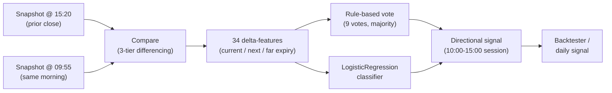
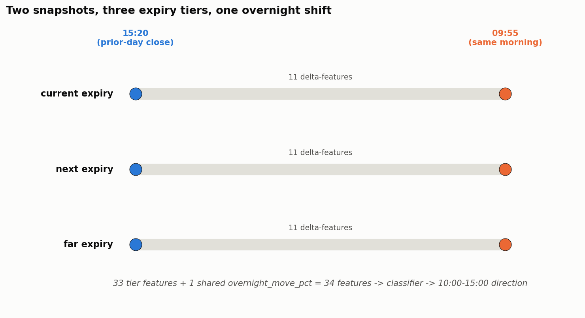
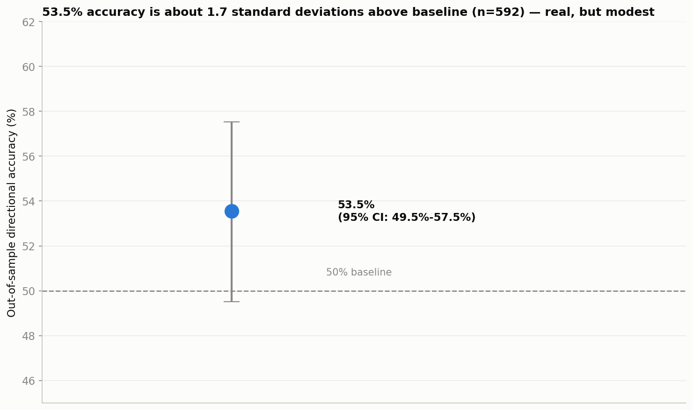
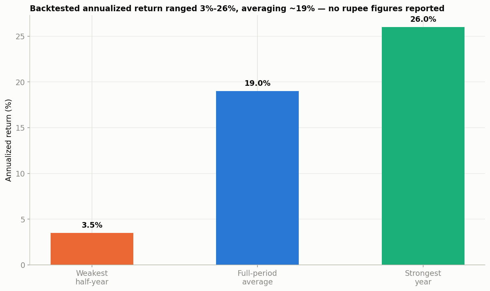

# Expiry Pyramid — NIFTY Futures Directional Model

A multi-expiry options-positioning signal for NIFTY: reads the current,
next, and far weekly option chains, scores the overnight shift in open
interest, put-call ratio, and net delta into a directional call for the
next session.

This is a live/future strategy under active development, not a closed,
historical backtest-only project.

## Result at a glance

| | |
|---|---|
| **Validation** | 10-fold expanding walk-forward, quarterly, Jul 2023 – Dec 2025 (2.5 years) |
| **Out-of-sample trades** | 592 |
| **Directional accuracy** | 53.5% (95% Wilson CI: 49.5–57.5%), ~1.73σ above the 50% baseline |
| **Feature set** | 34 delta-features (11 per expiry tier × 3 tiers + 1 shared) |
| **Backtested annualized return** | ~19% full-period average — 3.5% in the weakest half-year, 26% in the strongest year |

All numbers are from walk-forward out-of-sample backtests, not live
trading. No rupee amounts, point totals, or margin-size figures are
reported anywhere in this repository — only rates. Full derivation:
[`notebooks/01_eda_and_strategy_overview.ipynb`](notebooks/01_eda_and_strategy_overview.ipynb).

## Risk figures (from private backtest, not reproducible from this repo)

- **Win rate:** 43.6%, against a breakeven win rate of roughly 40.4%
  implied by the strategy's own win/loss payoff asymmetry — about 3
  percentage points of margin above breakeven.
- **Max drawdown:** roughly 21% of the capital allocated to the position,
  at its worst point in the walk-forward window.
- **Longest losing streak:** 10 consecutive trades.

These four figures come from a private backtest against the full
historical options-chain cache (not published in this repo) and can't be
independently recomputed from anything here — unlike the headline numbers
above, which are reproducible end-to-end via the public notebook (on the
sample) plus the documented production result.

## How it works



Two option-chain snapshots are captured each trading day — one at 15:20
(previous day's close) and one at 09:55 (same morning, just before the
10:00 entry window) — each covering three expiry tiers (current week, next
week, far week): total call/put OI, PCR, OI-weighted net delta, and IV
skew. The change between those two snapshots produces 34 delta-features
(11 per tier + 1 shared). A rule-based vote (3 factors × 3 tiers = 9
votes, majority wins, a tie skips the day) and a LogisticRegression
classifier both turn that shift into a directional call for NIFTY's
10:00→15:00 session; `backtester.py` evaluates the binary signal as a
credit-spread backtest over the same historical options-chain cache.

## Why logistic regression, not a tree ensemble

In the project's own model comparison, several classifiers were tried on
this feature set — XGBoost, RandomForest, LogisticRegression, and
LightGBM. Tree ensembles sometimes showed a split between accuracy and
profitability in shorter test windows (a model with lower raw accuracy
occasionally produced a higher point total by winning big on a few days,
which is a fragile thing to rely on). LogisticRegression was the model
that held up best across the full 2.5-year expanding-window walk-forward —
it's what's actually deployed in production. A small-sample bake-off on
the public 290-row sample (Figure 4) may not agree with this — that's
expected from a scattered, randomly-ordered sample and isn't itself
concerning; it doesn't restate or override the production choice.

## Charts



*Figure 1 — the method's schematic: two daily snapshots (15:20 prior
close, 09:55 same morning) across three expiry tiers, producing 34
delta-features (11 per tier + 1 shared). Illustrative, not a data-driven
result.*



*Figure 6 — the production model's actual validated result: 53.5%
directional accuracy (95% Wilson CI: 49.5–57.5%, n=592), about 1.73
standard deviations above the 50% baseline. Reconstructed as a chart from
the documented point estimate and interval (the 290-row sample has no
valid chronological order to recompute this from) — not a fabricated
number.*



*Figure 7 — backtested annualized return across the 2.5-year walk-forward
window: 3.5% in the weakest half-year, 26% in the strongest year, ~19%
full-period average. No rupee or point figures are reported anywhere in
this repo — only rates.*

The notebook also includes a dataset-overview, feature-distribution,
model-bakeoff, and confusion-matrix figure (Figures 2–5) — those are
sample-level diagnostics computed live on the public 290-row sample, not
production-model results, and aren't reproduced here. The bake-off in
particular (Figure 4) is explicitly caveated in the notebook as not a
sound basis for model selection on its own — the real
LogisticRegression-over-tree-ensembles choice came from the full
walk-forward evaluation, not this demo.

## What's in this repo vs what's private

- **Public, in this repo:** the pipeline code, the 3-tier
  snapshot-differencing method, the validated headline results above, and
  a 290-row random sample of engineered features (`data/sample/`) for
  running the notebook end-to-end.
- **Private, not in this repo:** the full 713-row feature table, the
  2,114 raw snapshot files it's derived from, the trained production
  model, and the historical options-chain cache — all proprietary and
  gitignored. The sample exists purely so the notebook can run for anyone
  reading the code; it is not the dataset the live model is trained or
  evaluated on.

## Repository structure

Flat by design — this is a small, single-purpose project:

- `snapshot.py`, `comparator.py`, `cache_reader.py` — core pyramid signal
- `ml_direction.py`, `daily_signal.py` — ML variant and morning runner
- `backtester.py` — credit-spread backtest over the binary signal
- `greeks.py`, `trading_calendar.py`, `config.py` — small vendored
  dependencies (Black-Scholes Greeks, a holiday-aware trading-day helper,
  and the handful of constants they use) so this project has no runtime
  dependency on any other repository
- `notebooks/` — the EDA/strategy-overview notebook, runnable end-to-end
  on `data/sample/`
- `assets/` — figures exported from the notebook

## Setup

```bash
pip install -r requirements.txt
```

### Data

This project does not fetch or generate its own historical options-chain
data. `cache_reader.py` expects a local cache at
`data/cache/rolling_options/<INDEX>/`, one JSON file per (period,
expiry-level, strike-offset, side) with minute-level `iv`, `oi`, `strike`,
`spot`, `close`, `timestamp` arrays. That cache is not included in this
repository — populate it yourself (or point `cache_reader.CACHE_DIR` at
wherever you keep it) before running anything that reads historical data.

`data/snapshots/`, `data/reports/`, `data/ml/`, and `models/` hold this
project's own generated snapshots, backtest reports, feature tables, and
trained model file. All are gitignored — this is a live strategy, and none
of that output is meant to be published.

A small, seeded random sample of the engineered feature table lives in
`data/sample/` (see `data/sample/NOTE.md`) purely so the notebook can run
end-to-end for anyone reading the code — it is not the dataset the
production model is trained or evaluated on.

## Usage

```bash
python snapshot.py 2025-01-15 1520        # capture one snapshot
python comparator.py 2025-01-15 2025-01-16  # compare two dates
python backtester.py 2025                 # credit-spread backtest for a year
python daily_signal.py                    # today's ML signal
python daily_signal.py --train            # retrain the production model
```

## Limitations and honest caveats

- **53.5% is "better than a coin flip, not yet proven decisively so."**
  The 95% confidence interval's lower bound sits just under 50% (49.5%) —
  this result, on its own, does not statistically rule out no edge at all
  at the 95% level, even though the point estimate is consistent with a
  real, modest edge.
- **592 trades over 2.5 years is enough to detect an edge exists, not
  enough to pin its size down precisely** — the confidence interval above
  is still wide relative to the point estimate.
- **No live forward-test yet.** Every number here comes from historical
  data the model (and the researcher) had already seen the shape of when
  the walk-forward was designed. Live, decided-in-advance paper-trading is
  the next real test, not more backtesting.
- **The model choice isn't re-confirmed on a rolling basis.** LogisticRegression
  beat the tree ensembles on the full walk-forward at the time this was
  built; that choice should be periodically re-checked as more data
  accumulates, rather than assumed to hold indefinitely.
- **Regime dependence untested.** Like the Datashots BTST system, this
  strategy has not been separately evaluated for how it behaves when
  volatility regimes shift meaningfully from what the training window saw.
- **The four risk figures above are not independently reproducible** from
  anything published in this repo — see that section.

## Disclaimer

For educational and research purposes. Not financial advice. Derivatives
trading carries significant risk of loss.

## Author

[LinkedIn](https://www.linkedin.com/in/mudit-popli-78558b206)
